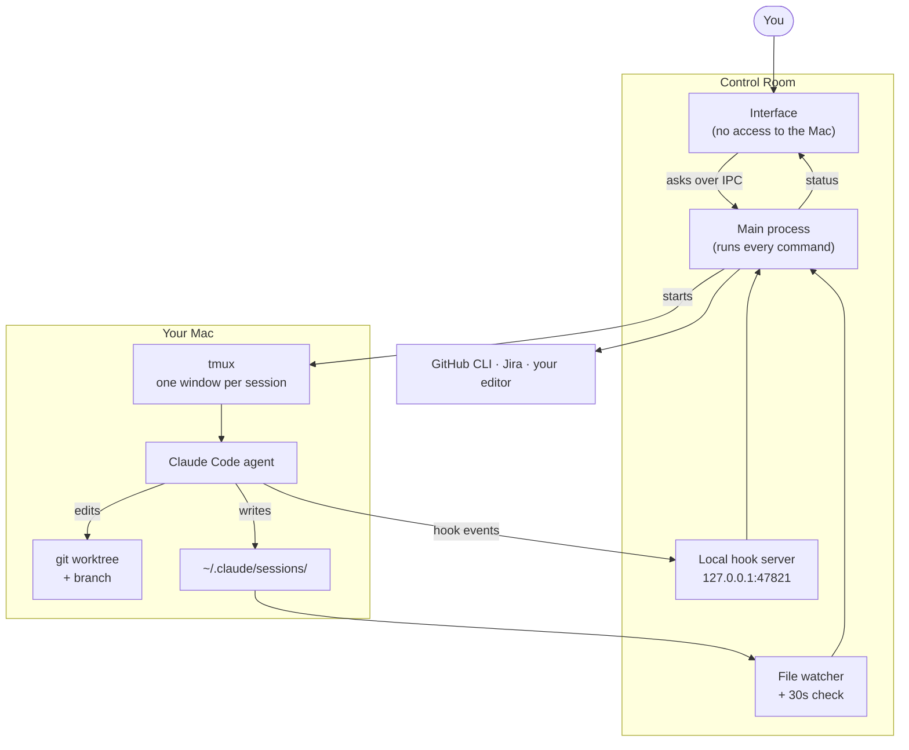

<p class="lede">In September I had a handful of Claude Code agents running in a handful of terminal tabs, and no idea which of them was waiting on me. So I built an app to fix that. This is how it went.</p>

Control Room is a Mac app for running lots of coding agents at once. It shows every agent I have going, flags the ones that need an answer, and lets me reply, review the diff, and open a pull request without leaving the window. It's open source on [GitHub](https://github.com/bradleycorrigan/control-room).

<figure class="shot">
  
  <figcaption>Answering an agent without going near its terminal. This is the bit I wanted most. (Kanagawa theme.)</figcaption>
</figure>

## The problem 🤯

Coding agents are good enough now that the slow part of my day wasn't the work. It was me. I'd start an agent, switch tabs to start another, and come back half an hour later to find the first one had been sat on a yes/no question the whole time.

Running several at once also meant they kept treading on each other in the same folder. One would switch branch while another was halfway through an edit.

I wanted three questions answered at a glance: which agents need me, what has each one changed, and is it ready to ship?

## The idea: one session = worktree + branch + tmux window 💡

The design came down to one decision. Every **session** gets three things of its own:

1. A git **worktree**, which is a second copy of the repo checked out in its own folder, so agents can't collide.
2. A **branch**, so each piece of work ends up as its own pull request.
3. A **tmux window**, so the agent keeps running even if I quit the app, and I can always attach to it from a normal terminal.

Control Room doesn't run the agents itself. It starts them in tmux, then watches. That kept the app simple, and it means a crash in my code never kills an hour of an agent's work.

<figure class="shot">
  
  <figcaption>Home. Type what you want, pick a project, and a new worktree, branch, and tmux window appear behind it.</figcaption>
</figure>

## Knowing what each agent is doing 👀

This was the hardest part. Claude Code doesn't offer an official "what are you doing?" API. It does write a small file per running session in `~/.claude/sessions/`, and it supports **hooks**: commands or web requests it fires on events like "finished a turn" or "needs permission".

So status comes from two places:

- **Hooks, when installed.** Claude Code posts each event to a tiny server the app runs on `127.0.0.1`. Status updates the moment something happens.
- **The session files, always.** The app watches them, and checks again every 30 seconds. Without hooks you lose "done" and "errored", but everything else still works.



<p class="caption">How a session runs. The app starts the agent in tmux, then listens: hooks for instant updates, the session files as a fallback.</p>

Agents inside a dev container were trickier, because `127.0.0.1` inside a container is the container, not my Mac. The fix was to start them with an address that points back out, plus a secret token so nothing else can post fake events:

```bash
env CR_HOOK_URL='http://host.docker.internal:47821/hook/container/<session>?token=<token>' claude …
```

<div class="shot-pair">
  <figure class="shot">
    
    <figcaption>The agent's commands and edits fold into one line, so the conversation stays readable.</figcaption>
  </figure>
  <figure class="shot">
    
    <figcaption>Jira tickets live in the same app, so I can start a session straight from one.</figcaption>
  </figure>
</div>

## The stack 🧱

| Piece | Why |
| --- | --- |
| Electron + React + TypeScript | A real desktop app with notifications and a Dock icon, written in the language I'm fastest in. Built with electron-vite. |
| tmux | Keeps agents alive outside the app. Every tmux call goes through one function. |
| xterm.js + node-pty | A proper terminal inside the app, drawn with WebGL. node-pty is the only native module allowed. |
| git worktrees | One folder per session, cleaned up when its branch merges. |
| GitHub CLI | Pull request status and the Ship button. |
| Jira Cloud API | The Tickets screen. The token sits encrypted in the Mac's Keychain. |
| Claude Haiku | Suggests a short name for each new session. |

There's no server, no account, and no sign-in. Everything runs on the Mac and talks to tools that are already installed.

## Bugs that each cost me a day 🪤

The best lessons came from bugs that only showed up in the real world. I keep these in the repo's `CLAUDE.md` so no agent makes them twice.

<div class="trap">
  <h3>tmux quietly rewrites control characters</h3>
  <p>Opened from the Dock, the app has no language setting. tmux then decides the terminal can't handle special characters and swaps them all for <code>_</code>. That broke the separator I used to split its output, so every new session failed to start, but only in the installed app and never in development. The fix: pass <code>-u</code> and set a UTF-8 locale on every tmux call.</p>
</div>

<div class="trap">
  <h3>Two timestamps that never match</h3>
  <p>Claude Code writes a process start time in UTC, month first. <code>ps</code> prints the same moment day first, in local time. Same instant, different text, so they never compared equal. Now I only compare raw milliseconds.</p>
</div>

<div class="trap">
  <h3>The pane's process isn't Claude</h3>
  <p>tmux gives you the process ID of the pane's shell, and Claude runs as a child of that shell. Matching on it pointed at the wrong thing. The session file holds the tmux window name, so I join on that instead.</p>
</div>

## The themes 🎨

I wanted it to look like something I'd choose to keep open all day, so I held it to the standard of [Linear](https://linear.app): calm, dense, and keyboard-first. It has 19 themes, all ported from editor themes people already love. Click through a few:

<div class="theme-gallery">
  <div class="theme-picker" role="group" aria-label="Choose a theme">
    <button type="button" data-shot="rose-pine" aria-pressed="true">Rosé Pine</button>
    <button type="button" data-shot="catppuccin-mocha" aria-pressed="false">Catppuccin Mocha</button>
    <button type="button" data-shot="kanagawa" aria-pressed="false">Kanagawa</button>
    <button type="button" data-shot="everforest-dark" aria-pressed="false">Everforest</button>
    <button type="button" data-shot="nord" aria-pressed="false">Nord</button>
    <button type="button" data-shot="gruvbox-dark" aria-pressed="false">Gruvbox</button>
    <button type="button" data-shot="rose-pine-dawn" aria-pressed="false">Rosé Pine Dawn</button>
    <button type="button" data-shot="catppuccin-latte" aria-pressed="false">Catppuccin Latte</button>
  </div>
  <figure class="shot">
    
    
    
    
    
    
    
    
    <figcaption>The same Sessions screen in eight of the 19 themes. Status is always a colour and a word, so it still reads if you can't tell the colours apart.</figcaption>
  </figure>
</div>

<script>
document.querySelectorAll('.theme-gallery').forEach(function (g) {
  var buttons = g.querySelectorAll('.theme-picker button');
  var shots = g.querySelectorAll('img[data-shot]');
  buttons.forEach(function (b) {
    b.addEventListener('click', function () {
      var id = b.getAttribute('data-shot');
      buttons.forEach(function (x) { x.setAttribute('aria-pressed', String(x === b)); });
      shots.forEach(function (img) { img.hidden = img.getAttribute('data-shot') !== id; });
    });
  });
});
</script>

A few rules keep 19 themes from turning into 19 sets of bugs:

- **Every colour is a token.** A hex code typed straight into a component fails the build.
- **Contrast is checked in every theme, on every build.** Body text needs 4.5:1, muted text and status dots 3:1. If a theme fails, the theme gets fixed. The rule never gets waived.
- **One component per idea.** The list and the grid share the same heading, filter menu, and chips, so they can't drift apart.
- **No AI tells.** No emoji in the app, no icon on every row, no identical big button repeated down a list.

## Building it with agents 🤖

Most of the code was written by Claude Code agents, with me writing the plans and reviewing the work. That made the testing setup the most important thing I built.

One command, `npm run gate`, prints PASS or FAIL. It type-checks, lints, builds, runs the contrast check, and then drives the real app with real clicks and key presses against a fake project full of seeded sessions and live tmux panes. Nothing reaches `main` until it passes.

> A check runs against the real app, or it's reported as unrunnable. Agents love to "verify" a component by rendering it on its own. Those results were worthless in both directions.

A few things I learnt the hard way:

- **Gate runs aren't free.** One day went on about 30 of them. Now the rule is: before re-running, ask what the run will tell you that you don't already know.
- **Make failures explain themselves.** Every failed check prints a snapshot of what was on screen: open dialogs, focus, and toasts. That usually answers the question without another run.
- **Small fixtures, then real volume.** The fake project is tiny so checks can count exactly. Some checks add 60 realistic tickets, look at the layout, then take them away, after two layout bugs shipped that only showed up with real numbers.
- **A sleep that looks pointless often isn't.** Swapping 42 fixed waits for "wait until" checks at once made every run fail somewhere different.

## Making it fast ⚡

- **Faster tests.** The page checks took about 140 seconds. Splitting them across four app windows running side by side brought that down to about 60. The whole gate now runs in under two minutes.
- **Chat.** Messages are drawn once and skipped while off screen. Transcripts are read from where the app left off, not from the top each time.
- **Jira.** The board shows last time's tickets straight away, then refreshes behind them.
- **GitHub.** Pull request lookups are shared and cached, instead of each card asking on its own.

<figure class="shot">
  
  <figcaption>The newest screen: every page my agents have published, pieced together from session history, because there's no API for the list.</figcaption>
</figure>

## What I'd tell myself at the start 📝

- **Lean on tools that already exist.** tmux, git worktrees, and the GitHub CLI do the heavy lifting. My code mostly watches and connects them.
- **Plan for the parts you don't control.** Claude Code's session files aren't a public API. All the parsing lives in one file, and a session it can't read shows as "unknown" instead of breaking the list.
- **A button only exists if it works.** No greyed-out features and no "coming soon". If it isn't built, it isn't on screen.
- **Invest in testing before you need it.** With agents writing most of the code, the gate is what lets me trust a change I didn't type.

---

<p class="signoff">462 commits over two months, about 61,000 lines of TypeScript. Mac only, MIT licence. The code is on <a href="https://github.com/bradleycorrigan/control-room">GitHub</a>. Every screenshot here uses the app's built-in example data.</p>
