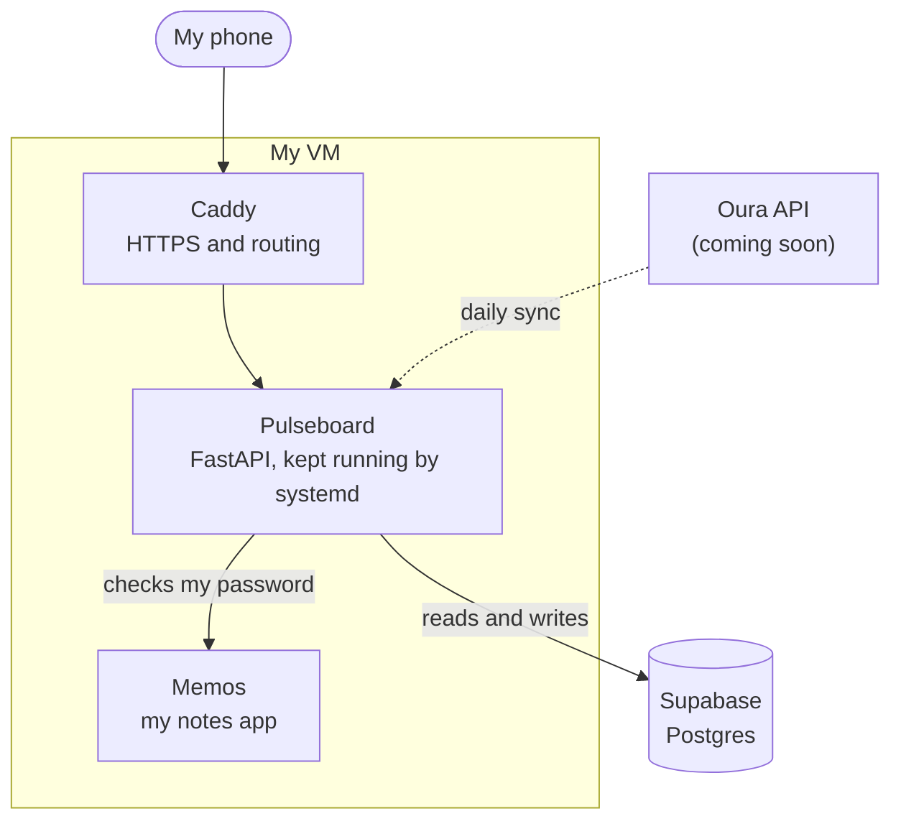

I pay for a gym membership every month, and I wanted a straight answer to one question: am I actually getting my money's worth? So I built a small app to log every session and tell me.

Pulseboard is a workout tracker made for exactly one person: me. I log a gym session, a swim, or a sauna in a couple of taps, and it shows me how much value I've had from the membership this month, what mix of sessions I'm doing, and how often I actually go. It started life in June as a quick weekend project and has been rebuilt twice since, most recently with Claude Code doing most of the typing.

  <figure class="shot">
    
  </figure>
  <figure class="shot">
    
  </figure>
  <figure class="shot">
    
  </figure>

Logging a session, the membership maths, and the mix of sessions each month. Every screenshot here uses made-up demo data.

## The idea: price every visit 💷

The trick that makes the whole thing work is giving every session a price: what it would have cost me to pay as I go. A gym visit is £15, a pool swim is £6.80, a lido swim is £6.40, and a sauna is £18.70. Add those up over a month and compare the total to the membership fee, and you get a very honest number.

That turns "I should go more" into something I can see. The Membership value card shows how much I've had back this month, the day I paid it off, my cost per visit, and whether I'm ahead of or behind last month by the same day.

The other cards look at the longer run. Value by month stacks each month's sessions by type, so I can see the mix shift between gym, pool, lido, and sauna, with a line at the fee. Month by month adds visits, cost per visit, and how many days I was active, and a heatmap shows every day of the last few months at a glance.

## Version one: quick, public, and slow 🐌

The first version was a FastAPI app with a Supabase database, charts drawn with Plotly, and hosting on Vercel's free tier. It did the job, but it had two problems:

- **It was slow to wake up.** Vercel runs apps like this as serverless functions, so after a quiet spell the first visit took about eight seconds. That's a long time to stand at a gym reception holding your phone.
- **It had no sign-in.** Anyone with the address could see my data, which for personal data isn't great.

## Moving it onto my own server 🖥️

I already run a small server for my notes app: a free virtual machine on Oracle Cloud's Always Free tier, with two ARM cores and 12 GB of memory. So Pulseboard moved in next door.

Caddy serves the app over HTTPS, the app stays running all the time, and the data still lives in Supabase.

- **It's always on.** The app runs as a normal service that never goes to sleep, so pages open instantly.
- **One login for everything.** Pulseboard signs me in with the same account as my notes app, then keeps me signed in for a month. Only my account is allowed in.
- **The database stayed put.** Supabase was never the problem, so it's still where everything is stored. The app talks to it directly with plain SQL.
- **Free means you have to look busy.** Oracle reclaims free machines that sit idle for a week, so the server runs a small, low-priority job that keeps it just busy enough to count as in use.

Having the app on a machine I control has another upside: Claude Code can work on it in place. It edits the code, restarts the service, and checks the result on my phone-sized screen, all in one go.

## The style 🎨

The look came in two steps.

First, I gave it the design language from [Control Room](/posts/building-control-room/): the same layout rules, the same components, and all 19 of its editor themes. Then I gave it a look of its own, which I call **Paper**: warm off-white like a notebook, Instrument Serif for headings and big numbers, and IBM Plex Mono for everything else. It's now the default, with a matching dark version, Paper Night, for evenings.

  <figure class="shot">
    
  </figure>
  <figure class="shot">
    
  </figure>
  <figure class="shot">
    
  </figure>

Three of the editor themes it inherited from Control Room: Tokyo Night, Rosé Pine Dawn, and Catppuccin Mocha. You can follow the phone's light or dark setting, or pick one and keep it.

A few things made the biggest difference to how it feels:

- **It's built for a phone first.** I use it standing in a changing room, so everything is big enough to tap with a thumb and the important number is always at the top.
- **Logging feels instant.** When I tap Log workout, the entry appears straight away while it saves in the background. If saving fails, it's taken back out and I get a Try again button.
- **Charts are hand-made.** I dropped Plotly and drew the charts myself, which made the pages much lighter and let every chart match the theme.
- **It's tested against awkward data.** A demo copy runs with fake data, and a switch fills it with the worst cases (no entries, one entry, or silly numbers) so I can see nothing breaks.

  <figure class="shot">
    
    <figcaption>Workout days. Tap any day to see what I did.</figcaption>
  </figure>
  <figure class="shot">
    
    <figcaption>Month by month, against the fee.</figcaption>
  </figure>

## Next: the Oura ring 💍

I've ordered an Oura ring and I'm waiting for it to arrive. Once it does, I want Pulseboard to pull in my daily numbers from Oura's official API, so they sit next to my workouts:

- **A Today screen** with my readiness score and a simple suggestion, like "good day to push" or "take it easy".
- **Sleep, HRV, and resting heart rate**, so I can see how training and recovery line up over time.
- **Workouts matched automatically.** Oura notices when you're exercising, so a gym session could pick up its heart rate and calories by itself.
- **Free exercise counts too.** Oura can spot walks, runs, and bike rides. Those will be logged at £0, so they show up in my activity without inflating the membership maths.

The plan is a small job on the server that checks Oura every morning and saves anything new into Supabase. First, though, the ring needs a couple of weeks on my finger to learn what normal looks like for me. I'll write that part up when it's built.

---

FastAPI, Postgres on Supabase, and plain JavaScript, served by Caddy from a free Oracle Cloud VM. Every screenshot here uses the app's demo data.

